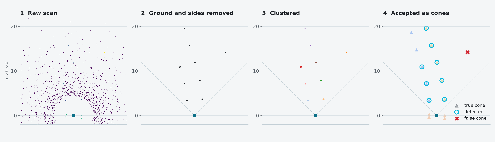
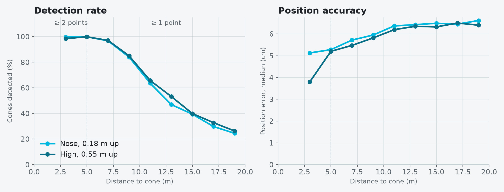

# Lidar cone detection: tests in simulation

Tests of the cone detector in `src/ion_perception/ion_perception/lidar_listener.py` on simulated
Livox Mid-360S scans, where the true position of every cone is known.

The test scripts live in the simulator repo, because they need its simulated lidar:
[Autonomous-car-sim, `sim/perception_eval/`](https://github.com/ION-Racing-UiS/Autonomous-car-sim/tree/lidar-listener-ros2/sim/perception_eval)
(the README there has how to run them).

- `eval_perception.py`: full test, writes the plots below.
- `tune_cones.py`: tries values for the point-count rule in `is_cone()` in about a second each.

## How the detector works

1. Remove the ground (points less than 5 cm above it) and everything outside 90° in front of the car.
2. Group points that are less than 0.3 m apart.
3. Keep the groups that are the size of a cone and have enough points for their distance.

## What we found

2290 simulated scans per lidar position, over 5 random tracks. A detection within 0.5 m of a true cone counts as found.

- Up to 8 m, at least 90 % of the cones are found in every single scan.
- Found cones are 4 to 7 cm from their true position (median).
- 0.4 ms per scan (Python on a laptop).
- 0.35 false cones per scan, from the simulated lidar noise.
- Beyond about 10 m a cone gets less than one lidar point per scan, so no rule can find all of them in one scan.
  The fix is to follow cones over several scans.
- The lidar position (low on the nose, 0.18 m up, or high, 0.55 m up) made little difference.
- Tuning the point-count rule (`NEAR_DIST = 5`, `MID_DIST = 10`, `MIN_PTS = 2 / 1 / 1`) raised the cones found per
  scan from 49 % to 66 % overall, at the cost of more false cones. The camera and tracking should filter those.

## Limits

Simulation only: nothing on the track but cones, no motion distortion, single scans. Good for comparing settings;
the absolute numbers need checking on real recordings.
